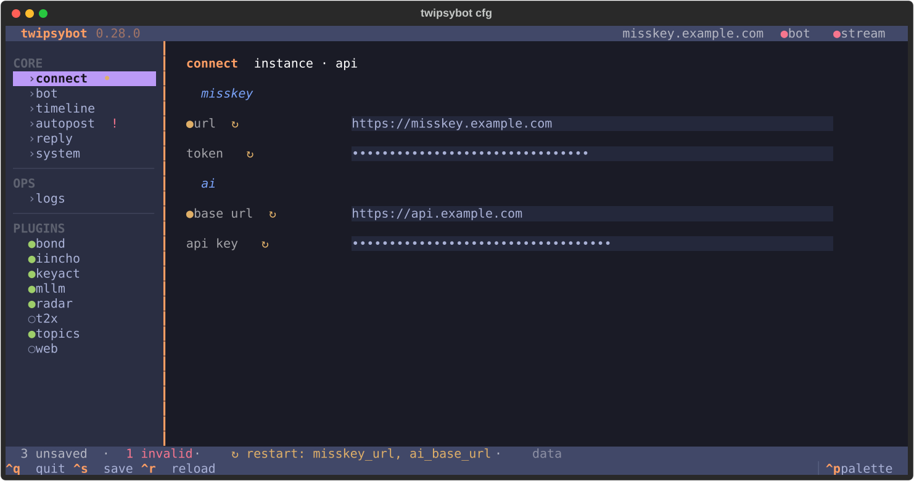

<div align="center">

<p>
    
</p>

<h1>TwipsyBot</h1>

<br>**一只轻量、插件化的 Misskey AI 机器人**

[oreeke.com/@ai](https://oreeke.com/@ai)

<a href="https://www.python.org/downloads">
    </a>
<a href="https://github.com/misskey-dev/misskey">
    </a>
<a href="https://github.com/oreeke/twipsybot/pkgs/container/twipsybot">
    </a>

<br>··· [使用手册](https://twipsybot.oreeke.com/) ··· [开发指南](https://twipsybot.oreeke.com/dev-guide/) ···
<br><br>💌<br><br>

</div>

<div align="left">

```bash
# copy & edit docker-compose.yaml

docker compose up -d
docker compose exec twipsybot twipsybot cfg

# done
```

</div>

<p align="center">
    
</p>
