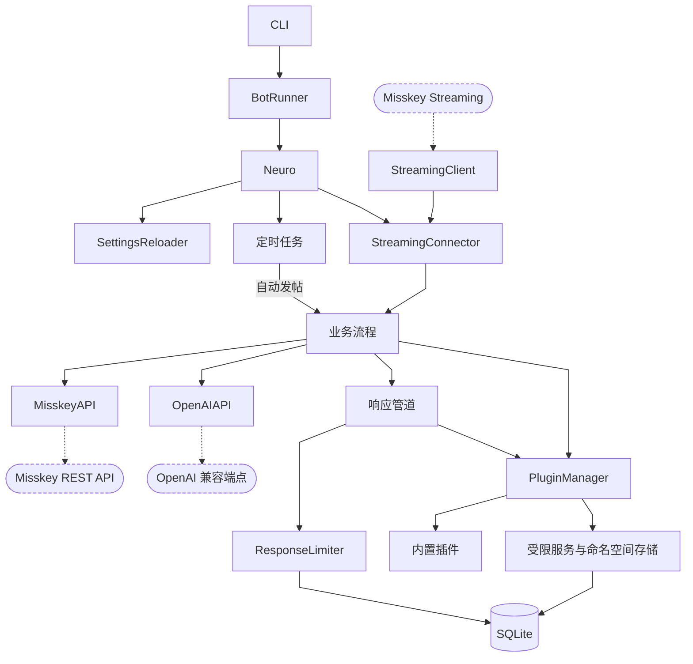

# 架构

单进程异步应用。核心负责连接、事件分发、设置热重载与状态管理，业务流程见[流程](flows.md)。

## 概览



## 目录

```text
twipsybot/
├── twipsybot/
│   ├── app/            CLI、进程启动、信号与退出码
│   ├── bot/
│   │   ├── admin/      管理命令
│   │   ├── engine/     核心编排、连接、热重载、限流、响应管道与运行状态
│   │   └── flows/      提及、聊天、通知与发帖流程
│   ├── clients/
│   │   ├── fetch/      公网出站抓取
│   │   ├── misskey/    REST 与 Streaming 客户端
│   │   └── openai/     OpenAI 兼容客户端
│   ├── db/             SQLite 状态存储
│   ├── plugin/         插件公共 API、契约与加载器
│   ├── shared/         配置模型、设置 IO、常量、异常、锁与工具
│   └── tui/            Textual 配置界面
├── plugins/            内置插件
├── tests/              测试用例
└── docs/               文档站点
```

`Neuro`（`bot/engine/core.py`）是对象图根：装配 engine 组件与 flows，编排启停，并作为 `bot` 供 flow 回调；插件仅经 `BotControlAdapter` 受限访问。

| 配置模块 | 职责 |
| --- | --- |
| `shared/config.py` | Settings、Secrets 模型；合并设置文件、连接信息与环境变量 |
| `shared/settings.py` | 设置文件读取、原子写入、默认值裁剪与补丁合并 |
| `bot/engine/reload.py` | `SettingsReloader`：轮询并热应用设置，标记需重启字段 |
| `tui/schema.py` | 由 Pydantic 模型生成表单 |
| `tui/app.py`、`app.tcss` | Textual 应用与样式 |

## 启动与停止

`twipsybot run` → `twipsybot.app.cli` → `BotRunner`：

1. 初始化日志，加载设置、连接信息与环境变量覆盖（仅 `connect` 支持环境变量）。
2. 配置无效、鉴权或连接失败时记录 `Startup blocked` 并等待设置变更；网络问题造成的连接失败每 60 秒重试。
3. 创建 `Neuro`，初始化 SQLite、自动发帖状态与机器人身份。
4. 加载插件与管理命令，执行 `on_startup()`。
5. 启动设置轮询与定时任务，连接 Streaming。
6. 收到信号后依次关闭轮询器、插件、客户端与数据库。

Linux 处理 `SIGINT`、`SIGTERM`、`SIGHUP`，Windows 处理 `SIGINT`、`SIGTERM`。停止时先暂停新 Hook，再等待进行中的 Hook。

## 热重载

`SettingsReloader` 约每 2 秒检查 `settings.yaml`、`secrets.yaml` 及 `bot.system_prompt`、`autopost.prompt` 引用的 `prompts/*.md`（或 `*.txt`）：

- 有效变更即时应用，无效文件记录错误并保留当前设置。
- 插件配置变更由 `PluginManager` 以新配置重建对应插件。

| 变更键 | 动作 |
| --- | --- |
| `bot.model`、`bot.api_mode` | 更新 OpenAI 客户端 |
| `autopost.mode` / `interval` / `times` | 重建自动发帖任务 |
| `timeline.*` | 增删时间线与天线 Channel，无需重连 |
| `system.allow_nets` | 更新抓取放行网段 |
| `system.log_level` / `dump_events` | 即时调整日志 |
| 其余（回复、名单等） | 业务代码每次读取最新值，无需动作 |

`twipsybot cfg` 保存时合并到最新文件且只写非默认字段，避免覆盖管理命令的并发写入。

## 数据与并发

- SQLite（WAL）：`plugin_data`、`response_limit_state`、`auto_post_state`。
- 插件仅通过命名空间隔离的 `PluginStorage` 读写字符串。
- 回复限制状态带内存缓存，以 SQLite 为准；聊天历史短期缓存，过期从 Misskey 重新获取。
- actor lock 串行化同一用户的操作；不同用户与事件并发，共享内存状态需自行同步。
- 关闭时为 Hook 保留 3 秒，整体最多 5 秒；Hook 与生命周期超时见[插件开发](plugins.md#约束)。

## 修改原则

- 协议差异放 `clients`，业务流程放 `flows`，跨流程状态与调度放 `engine`。
- 设置读写统一走 `shared.config` 与 `shared.settings`，不直接解析 YAML。
