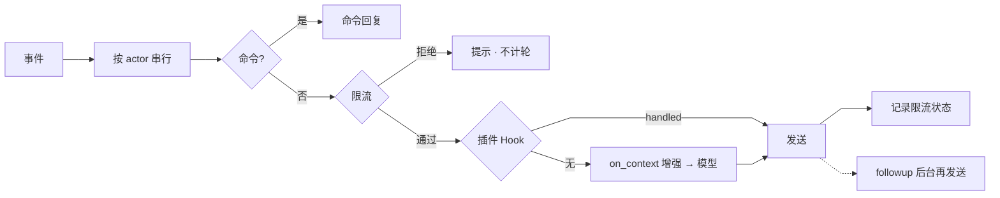
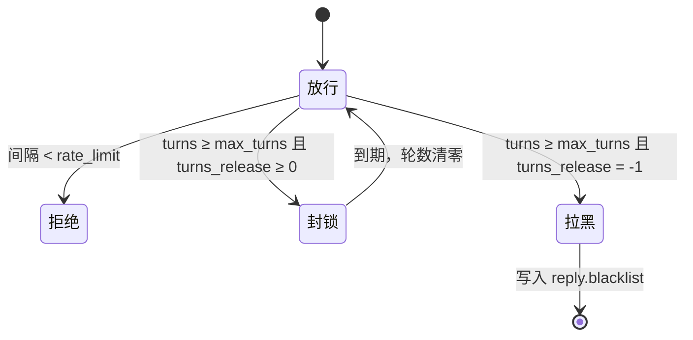

# 流程

`bot/flows` 负责把规范化事件转为业务行为，`bot/engine` 提供限流、管道与调度。

## 响应管道

提及与聊天共用 `ResponsePipeline.respond()`，flow 只提供 `generate`（AI 生成）与 `deliver`（发送）两个回调。

- 同一用户（群聊为房间）在同一把锁内串行，`^` 与 `/` 命令先于管道处理；提示、命令与管理回复不计轮数，只有插件与 AI 回复计入。
- `on_message` / `on_mention` 首个 handled 结果即为回复，`followup` 在后台完成后二次发送。
- 未被接管时，`on_context` 的结果合并为 `Augment`：`context` 前置，`text` 改写用户原文，`media` 作为多模态输入。

## 提及

`MentionHandler` 在 `reply.mention` 开启时处理：

1. 过滤自提及、Bot 账号与黑名单。
2. 受理判定：`reply` 事件仅在回复机器人的帖子时受理；`mention` 事件须 `mentions` 含机器人，且回复机器人的帖子不重复受理，避免同一帖触发两次。
3. 构造提示：当前正文，附加被引用帖（`Quote`）与父帖（`Replying to`）。
4. 回复链：经 `notes/conversation` 取最近 `reply.memory` 条祖先，保留根帖、父帖及机器人与当前用户的发言，转为多轮消息并按 `reply.ctx_tokens` 截断。

## 聊天

`ChatHandler` 在 `reply.chat` 开启时处理：

- 会话键：私聊为对方用户 ID，群聊为 `room:{id}`；群聊须 `@` 机器人，且正文带 `用户名:` 前缀以区分发言人。
- `@` 判定：用户名带 host 时须等于本站，避免 `@bot@other.host` 误触发。
- 历史：首次从 Misskey 聊天记录懒加载，缓存 1 小时（最多 1000 个会话）；每轮回复后增量追加并去重，请求前按 `reply.memory` 与 `reply.ctx_tokens` 截断。
- 群聊中 `^` 命令被忽略，私聊 `^` 仅管理员可用。

## 回复限制

`ResponseLimiter` 按用户 ID 维护 `(last_reply_ts, turns, blocked_until_ts)`，内存 TTL 缓存 24 小时，写穿 SQLite，每日 03:00 清理过期记录。

- 自动拉黑经 `SettingsReloader.update()` 写回 `settings.yaml`。

## 自动发帖

`AutoPostService` 由 APScheduler 驱动，模式切换时重建任务：

| 模式 | 触发 | 说明 |
| --- | --- | --- |
| `rotation` | 固定间隔，启动后约 1 分钟首次执行 | 受 `daily_max` 约束 |
| `schedule` | 多个 `HH:MM` 的 cron 组合 | 不限次数 |

每次执行：

1. 调用 `on_auto_post`，优先发布首个带 `contents` 的插件结果（多条间隔 10 秒，逐条确认 `on_auto_post_published`）。
2. 否则取首个带 `prompt` 的结果作为前缀，与 `autopost.prompt` 拼接后交由模型生成。
3. 发帖前后检查并递增当日计数（持久化于 SQLite，跨日自动归零）。

任务 `coalesce` 并带 5 分钟 misfire 宽限，停机期间错过的执行不会补发多次。

## 定时维护

| 时间 | 任务 |
| --- | --- |
| 00:00 | 重置当日发帖计数 |
| 02:00 | SQLite `VACUUM` |
| 03:00 | 清理过期回复限制状态 |
