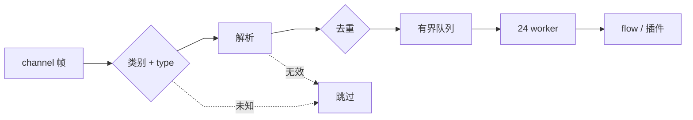

# Misskey

REST 查询与写入，Streaming 接收实时事件，协议适配集中在 `twipsybot/clients/misskey`。业务代码调用客户端方法，不自行拼接 endpoint、认证参数或 WebSocket 消息；插件使用 [`PluginContext.misskey`](plugins.md#misskey-与-drive)，未封装的端点经其 `call_api()` 复用同一请求通道。

基于 Misskey API `2026.9.0`，随官方更新同步维护。

## REST

| Endpoint | 用途 | 客户端方法 |
| --- | --- | --- |
| `i` | 机器人账号 | `get_current_user()` |
| `notes/show` | 获取帖子 | `get_note()` |
| `notes/create` | 发帖、回复、引用、转帖 | `create_note()`、`create_renote()` |
| `notes/conversation` | 回复链（由近及远） | `get_note_conversation()` |
| `notes/delete` | 删除帖子 | `delete_note()` |
| `notes/reactions/create` | 添加反应 | `create_reaction()` |
| `users/notes` | 用户帖子 | `get_user_notes()` |
| `users/show` | 用户信息 | `show_user()` |
| `users/update-memo` | 写入个人备注 | `update_user_memo()` |
| `antennas/list` | 天线列表（缓存 30 秒） | `list_antennas()` |
| `chat/messages/create-to-user` | 发送私聊 | `send_message()` |
| `chat/messages/create-to-room` | 发送群聊 | `send_room_message()` |
| `chat/messages/user-timeline` | 私聊记录 | `get_messages()` |
| `chat/messages/room-timeline` | 群聊记录 | `get_room_messages()` |
| `drive/files/show` | 文件信息 | `drive.show_file()` |
| `drive/files/create` | 上传文件 | `drive.upload_bytes()` |
| 文件 URL（`GET`） | 下载文件 | `drive.fetch_bytes()`、`drive.download_bytes()`，经 `clients/fetch` 校验目标 |

- 共享 32 并发槽位，单次超时 60 秒，统一经 `MisskeyAPI` / `MisskeyDrive` 复用会话与约束。
- 读请求对连接错误与限流最多重试 2 次（指数退避加抖动，遵循 `retry_after`，上限 60 秒）；写请求不重试，避免重复提交。
- 帖子最长 3000 字符、聊天 2000 字符，客户端统一安全截断。
- 可见性、联合范围与权限由服务端校验收敛；指定可见帖子按事件原可见性回复。

## Streaming

| Channel | 事件 |
| --- | --- |
| `main` | 提及、回复、通知与新聊天消息（始终连接） |
| `homeTimeline` · `localTimeline` · `hybridTimeline` · `globalTimeline` | 对应时间线帖子 |
| `antenna` | 指定天线帖子 |
| `chatUser` · `chatRoom` | 指定用户 / 房间的聊天消息 |

- 自动断线重连与 Channel 恢复，动态聊天订阅以 `pong` 确认；单连接最多 32 个 Channel。
- 断线期间待发消息有限缓冲，溢出时丢弃最早消息。

## 事件规范化

`events.py` 的 `EventRouter` 把 Streaming 帧收敛为不可变事件，flow 与插件只见规范化结果，不见 WebSocket 结构。

| 路由（Channel 类别 · type） | 事件 | 说明 |
| --- | --- | --- |
| `main` · `mention` / `reply` | `MentionEvent` | `kind` 区分；回复机器人帖子时两类可能同时到达，由 flow 判定 |
| `main` · `notification` / `unreadNotification` | `NotificationEvent` | |
| `main` · `newChatMessage`、`chatUser` / `chatRoom` · `message` | `MessageEvent` | `room_id` 区分私聊与群聊 |
| 时间线、`antenna` · `note` | `TimelineNoteEvent` | 注入来源 `channel` |

- **容错解析**：缺 `id` 的 payload 丢弃并告警，缺失的用户字段降级为 `unknown`、文件 URL 等为 `None`；模型保留 `raw` 以读取未建模字段。
- **统一语义**：`cw` 与正文合并为 `body`；文件取 `files` 与 `fileIds`（聊天为 `file` 与 `fileId`）并按 ID 去重；`MentionEvent` 内联 `reply`、`renote`（仅一层）并聚合 `attachments`。
- **聊天订阅**：`main` 的聊天事件缺少发送者详情时，由按用户缓存的 `fromUser` 补全；收到后按需订阅对应 `chatUser` / `chatRoom` 以发送 `read` 回执，空闲 120 秒退订。
- **去重键**：事件 ID 短期（10 分钟）去重；时间线按 `Channel + 帖子 ID`，聊天与通知跨 Channel 共用同一键，避免 `main` 与专属 Channel 重复投递。
- **并发**：24 个 worker 消费 1000 容量队列，入队等待 1 秒仍满则丢弃；单个 handler 异常只记录，不影响其他事件。
- **新增事件**：在客户端层注册路由与解析器，再由 flow 转为业务行为或插件事件，下游不依赖原始结构。

## 出站抓取

`clients/fetch` 的 `PublicFetcher` 是所有用户可控 URL（Drive 附件、网页、插件 `http`）的唯一出口，默认仅允许公网目标：

- 在 DNS 解析之后按实际 IP 校验（含 NAT64 还原），而非仅检查主机名，防止 DNS rebinding。
- 禁用自动重定向，逐跳重新校验，最多 3 跳；仅 `http` / `https`，不带 Cookie。
- `system.allow_nets` 追加放行网段，热重载即时生效；Misskey 实例自身为免校验源，保证本站 Drive 可下载。
- 响应流式读取并按调用方上限截断或拒绝，Drive 下载默认上限 32 MiB。

## 权限

| 权限 | 场景 |
| --- | --- |
| `read:account` | 账号、时间线、天线 |
| `write:notes` | 回复、发帖、引用、转帖 |
| `read:chat` · `write:chat` | 读写聊天 |
| `read:drive` · `write:drive` | 读取、上传文件 |
| `write:reactions` | 添加反应 |
| `write:account` | 写入个人备注（`users/update-memo`） |

新增 API 能力时，同步更新[快速开始](../user-guide/getting-started.md)的权限表并保持最小权限。

## 错误与测试

- 错误分为参数、认证、权限、未找到、文件过大、限流与连接，保留 `status`、`code`、`retry_after`；上层不吞异常。
- 测试不依赖真实例：REST 模拟 HTTP 响应，Streaming 构造事件与连接替身。新增 endpoint 或 Channel 至少覆盖成功、认证或参数失败、连接失败，以及有副作用的重试边界。
